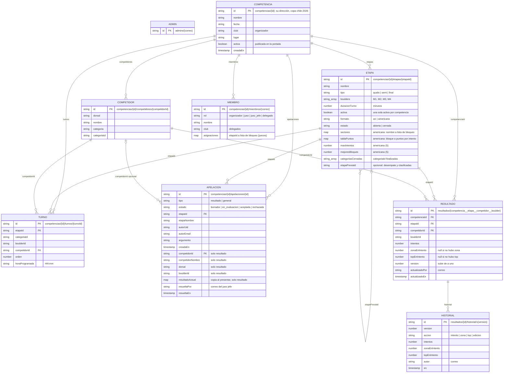

# Modelo de datos

Competidores, etapas, turnos, miembros y apelaciones viven dentro de cada competencia. Los resultados están en una colección aparte para que la misma persona pueda tener un marcador distinto en qualis y en la final.



## Competencias

El id de cada competencia es su dirección (`/copa-chile-2026`), así que se elige al crearla y no cambia. Pueden correr varias competencias al mismo tiempo; `activa` solo indica si aparece en la portada. Dentro de cada competencia, una etapa está activa.

## Roles

| Rol | Dónde | Qué puede hacer |
| --- | --- | --- |
| Admin | `admins/{correo}` | La plataforma: crear competencias, publicarlas en la portada y configurar cualquiera. Se crea a mano en la consola. |
| Organizador | `miembros/{correo}` con `rol: organizador` | Configurar solo su competencia: datos, etapas, competidoras, turnos y miembros. No la publica en la portada. |
| Juez | `miembros/{correo}` con `rol: juez` | Anotar en los bloques que tiene asignados en cada etapa. Leer apelaciones. |
| Juez jefe | `miembros/{correo}` con `rol: juez_jefe` | Anotar en todos los bloques y resolver apelaciones. |
| Delegado | `miembros/{correo}` con `rol: delegado` | Presentar apelaciones y ver solo las suyas. |

El rol es por competencia: el mismo correo puede ser juez en una fecha y delegado en otra. El id del miembro es el correo en minúsculas, porque las reglas lo comparan con el correo del token de Firebase Auth.

Ser admin no da permiso para anotar: un admin que también juzga tiene que agregarse como miembro.

## Resultado

Hay un documento por competidora, bloque y etapa. Guarda el estado actual. Cada cambio deja además una entrada en `historial`, en el mismo batch.

El id se arma así:

```text
{competenciaId}__{etapaId}__{competidorId}__{boulderId}
```

Ejemplo: `baguales-2026__final__abs_damas_4__M1`. Las reglas verifican que el id coincida con los campos.

`zonaEnIntento` y `topEnIntento` son el número de intento en que se consiguieron. `null` significa que todavía no hay zona o top. Un top sin zona previa deja la zona en el mismo intento.

Los puntos no se guardan. Se calculan al mostrar el tablero a partir de `topEnIntento` y `zonaEnIntento`, así que una corrección del juez o un cambio de fórmula no deja puntajes desactualizados. Ver [Puntuación](puntuacion.md).

Nombre, dorsal y categoría no se copian en el resultado: el tablero los toma de `competidores`, que ya tiene cargados. Así una corrección del nombre se ve de inmediato.

### Versión y escrituras offline

Cada escritura tiene que traer `version` = versión anterior + 1. Una tablet que anotó sin red y vuelve horas después con una versión atrasada recibe un rechazo, en lugar de pisar una corrección hecha desde otro dispositivo. La tablet muestra el aviso y vuelve al valor vigente.

Los resultados anteriores a este cambio no tienen `version`. Se leen como versión 0.

## Etapas

`estado: cerrada` bloquea toda escritura de resultados en la etapa. El admin la cierra al terminar y la puede reabrir.

`categoriasCerradas` finaliza categorías sueltas dentro de una etapa abierta, por ejemplo cuando una final termina antes que otra. Las reglas bloquean los resultados de esas categorías y el tablero las marca como finalizadas.

`formato` define cómo se puntúa: `wc` (World Climbing, el valor por defecto) o `americana`. Una ronda americana tiene bloques `B1`…`BN` que comparten todas las categorías y no tiene turnos. Guarda en la etapa su tabla de puntos (`tablaPuntos`, por ejemplo `{ B1: [10, 8, 6, 4, 2], … }`), definida por los organizadores. Una etapa americana sin `tablaPuntos` usa la fórmula clásica. `sectores` agrupa los bloques que revisa cada juez; al asignar un sector a un juez se guardan sus bloques en `asignaciones`. Ver [Puntuación](puntuacion.md#ronda-americana).

`etapaPreviaId` encadena rondas: desempata el ranking con la posición en la etapa previa y permite generar el orden de paso con sus clasificadas.

## Apelaciones

Viven dentro de la competencia. Una apelación nunca cambia el marcador.

Una apelación particular guarda la competidora, el bloque y una copia del resultado que existía al presentarla. La corrección pedida va solo en el argumento. Una apelación general no guarda una competidora.

El delegado crea el borrador y lo envía a evaluación. El juez jefe la acepta o la rechaza desde la tablet. Aceptar no modifica el resultado: el juez jefe lo corrige aparte con Editar.

## Lo que no es una colección

Los bloques no tienen colección. Son la lista `boulders` de la etapa. Cada categoría usa los bloques en que tiene turnos: por ejemplo, W1–W4 para mujeres y M1–M4 para hombres. El tablero y la vista del delegado muestran solo esos.

`intentos` y `apelaciones` en la raíz son colecciones viejas. Las reglas ya no permiten leerlas ni escribirlas.

## Reglas

El archivo es `firestore.rules` y los tests están en `tests/rules/`.

- El público lee competencias, etapas, competidoras, turnos y resultados.
- Solo un admin crea competencias y las publica en la portada. Un admin o un organizador de la competencia escribe su configuración y sus miembros.
- Un juez escribe resultados solo en sus bloques asignados, con un marcador válido, en una etapa abierta y en una categoría no finalizada. El juez jefe, en cualquier bloque.
- En una ronda americana, además: no más intentos que `maxIntentos`, y el encadenado tiene que ser el último intento.
- Los resultados no se borran, ni siquiera el admin. El historial es solo-agregar y lo leen los jueces de la competencia.
- Un delegado crea apelaciones con su propio correo, edita sus borradores y lee solo las suyas.
- Solo el juez jefe resuelve una apelación, y nunca una propia.
- Nadie borra apelaciones ni historial.
