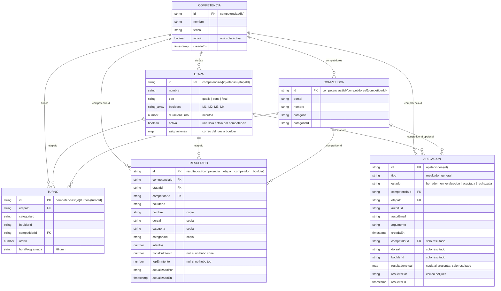

# Modelo de datos

Competidores, etapas y turnos viven dentro de cada competencia. Los resultados están en una colección aparte para que la misma persona pueda tener un marcador distinto en qualis y en la final.



## Resultado

Hay un documento por competidora, bloque y etapa. Guarda el estado actual, no un registro por cada toque.

El id se arma así:

```text
{competenciaId}__{etapaId}__{competidorId}__{boulderId}
```

Ejemplo: `baguales-2026__final__abs_damas_4__M1`.

Nombre, dorsal y categoría se copian en el resultado para que el tablero no tenga que leer la subcolección de competidores al pintar cada celda.

`zonaEnIntento` y `topEnIntento` son el número de intento en que se consiguieron. `null` significa que todavía no hay zona o top. Un top sin zona previa deja la zona en el mismo intento.

Los puntos no se guardan. Se calculan al mostrar el tablero a partir de `topEnIntento` y `zonaEnIntento`, así que una corrección del juez o un cambio de fórmula no deja puntajes desactualizados en Firestore. Ver [Puntuación](puntuacion.md).

## Apelaciones

`apelaciones` es una colección separada de `resultados`. Una apelación nunca cambia automáticamente el marcador.

Una apelación particular guarda la competidora, el bloque y una copia del resultado que existía al presentarla. La corrección pedida va solo en el argumento. Una apelación general guarda el contexto de competencia y etapa, pero no una competidora.

Los estados son `borrador`, `en_evaluacion`, `aceptada` y `rechazada`. El delegado crea el borrador y lo envía a evaluación. Un juez autenticado acepta o rechaza desde la tablet. Aceptar no modifica el resultado: el juez corrige el marcador aparte si corresponde.

## Lo que no es una colección

Los bloques no tienen colección. Son la lista `boulders` de la etapa.

La colección `intentos` queda en Firestore por las reglas viejas. La app ya no la lee ni escribe ahí.

## Reglas

El archivo del repo es `firestore.rules`.

- El público puede leer competencias, configuración y resultados.
- Solo usuarios autenticados pueden leer apelaciones.
- Solo un usuario con sesión iniciada puede escribir competencias, sus subcolecciones y `resultados`.
- El autor puede crear una apelación en `borrador` o `en_evaluacion`, y editarla mientras sigue en borrador.
- Un usuario autenticado puede pasar una apelación de `en_evaluacion` a `aceptada` o `rechazada`. No se pueden borrar.
- Todavía no hay un rol de administrador: cualquier juez autenticado puede editar la configuración.
